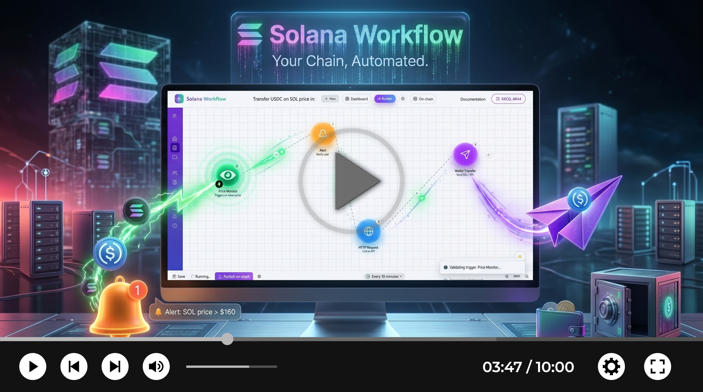

# Solana Workflow

> **Automate the Solana ecosystem using natural language and AI.**  
> Create, manage, and execute blockchain workflows without writing a single line of code.

---

## 🚀 Value Proposition
**Solana Workflow** removes the technical barriers to Web3 automation. We transform natural language instructions into structured, monitorable, and executable workflows on the Solana blockchain.

*   **No-Code:** No Rust or Anchor knowledge required to build sophisticated automation.
*   **AI-Powered:** Translates human intent into executable logic using Gemini and Grok.
*   **Decentralized Persistence:** Workflow definitions are stored on IPFS, with references tracked immutably on-chain via a Solana Program.
*   **Real-time Monitoring:** Control your automations and receive alerts exactly when your defined triggers occur.

---

## 🎥 Demo
<div align="center">
  <a href="https://youtu.be/tjctwyRoGsE?si=SAhd5vHIpqxKY7QV" target="_blank">
    
  </a>
  <p><em>Click to watch the introduction video</em></p>
</div>

<video src="public/solana-workflow.mp4" width="100%" controls muted poster="public/solana-workflow.jpg"></video>

---

## 💡 How It Works
1.  **Define your goal:** Describe what you want (e.g., *"Notify me when SOL price exceeds $200"*).
2.  **AI Processing:** Your request is processed by Gemini or Grok via Edge Functions to generate the workflow logic.
3.  **Decentralized Storage:** The resulting JSON workflow is pinned to **IPFS**, and its unique CID is anchored to a **Solana Program** for permanent, immutable reference.
4.  **Execution:** The system monitors the blockchain through Alchemy and executes actions automatically.

---

## 🛠 Tech Stack
Built with a modern, high-performance web development stack:

*   **Framework:** Next.js 16 (React 18, TypeScript)
*   **Edge Intelligence:** Supabase Edge Functions (Orchestrating Gemini & Grok APIs)
*   **Blockchain Integration:** @solana/web3.js, @solana/wallet-adapter, Anchor
*   **Decentralized Storage:** IPFS (via CID pinning)
*   **Database & Auth:** Supabase (SSR & JS Client)
*   **State Management:** TanStack React Query
*   **UI Components:** Radix UI, Tailwind CSS

---

## 🔗 Protocol & Data Integrations
Solana Workflow leverages industry-leading infrastructure to ensure high-speed execution and accurate data:

*   **Blockchain Infrastructure:** Powered by [Alchemy](https://www.alchemy.com/) for reliable, low-latency RPC communication.
*   **DeFi & Liquidity:** Integrated with [Jupiter Aggregator API](https://jup.ag/) for precise price discovery and optimized trade routing.
*   **Market Data:** Real-time analytics and liquidity tracking via [DexScreener API](https://dexscreener.com/).

---

## 🔔 Alert Channels

The **Alert** node can deliver to:

| Channel | What it needs |
| --- | --- |
| **In-App** | Nothing. Uses the notification center in the app (unread badge, persisted in the browser). |
| **Telegram** | `TELEGRAM_BOT_TOKEN` + a chat ID (node, Settings, or `TELEGRAM_CHAT_ID`). |
| **Discord** | A Discord webhook URL (node, Settings, or `DISCORD_WEBHOOK_URL`). |
| **Email** | `RESEND_API_KEY` + `ALERT_FROM_EMAIL` (verified sender). Optional default recipient: `ALERT_EMAIL_TO`. |
| **WhatsApp** | Meta Cloud API: `WHATSAPP_ACCESS_TOKEN` + `WHATSAPP_PHONE_NUMBER_ID`. Or Twilio: `TWILIO_ACCOUNT_SID` + `TWILIO_AUTH_TOKEN` + `TWILIO_WHATSAPP_FROM`. Optional default recipient: `WHATSAPP_TO`. |

Configure the server secrets once:

```bash
npx supabase secrets set --project-ref hessksbxjcfkmujiqhnr \
  TELEGRAM_BOT_TOKEN="..." \
  TELEGRAM_CHAT_ID="..." \
  RESEND_API_KEY="..." \
  ALERT_FROM_EMAIL="Solana Workflow <alerts@your-domain.com>" \
  WHATSAPP_ACCESS_TOKEN="..." \
  WHATSAPP_PHONE_NUMBER_ID="..."
```

Discord and WhatsApp can also be configured per node. Because a Discord webhook URL is a secret, prefer saving it in **Settings** instead of inside a workflow that may be pinned to IPFS.

The `send-alert` Edge Function exposes a read-only health check:

```bash
curl "$NEXT_PUBLIC_SUPABASE_URL/functions/v1/send-alert" \
  -H "Authorization: Bearer $NEXT_PUBLIC_SUPABASE_ANON_KEY"
```

It returns which server-side channels are configured (never the secret values). The **Send test alert** button in the Alert node uses the same path, so you can verify a channel before running a workflow.

---

## 🚀 Roadmap

### Phase 1: Core Automation & Integrations
*   **Enhanced Trigger Engines:** Expanding support for native **DexScreener** data streams (liquidity changes, volume spikes, new pair launches).
*   **On-Chain Execution Engine:** Implementing a robust on-chain function to automate the execution of published workflows, ensuring trustless, decentralized operation.
*   **Anchor Program Integration:** Deploying a Solana Program to manage IPFS CID references for every generated workflow, ensuring verifiability and auditability.

### Phase 2: Experience
*   **Workflow Templates:** A library of "one-click" automation recipes for common DeFi strategies.

### Phase 3: The Creator Ecosystem
*   **Marketplace Launch:** A decentralized hub where users can share, discover, and monetize custom automation workflows.
*   **Creator Monetization:** Reputation-based system where creators earn rewards based on workflow usage, community feedback, and deployments.
*   **Community Governance:** Introduction of points and rating systems to foster a high-quality ecosystem.

---
